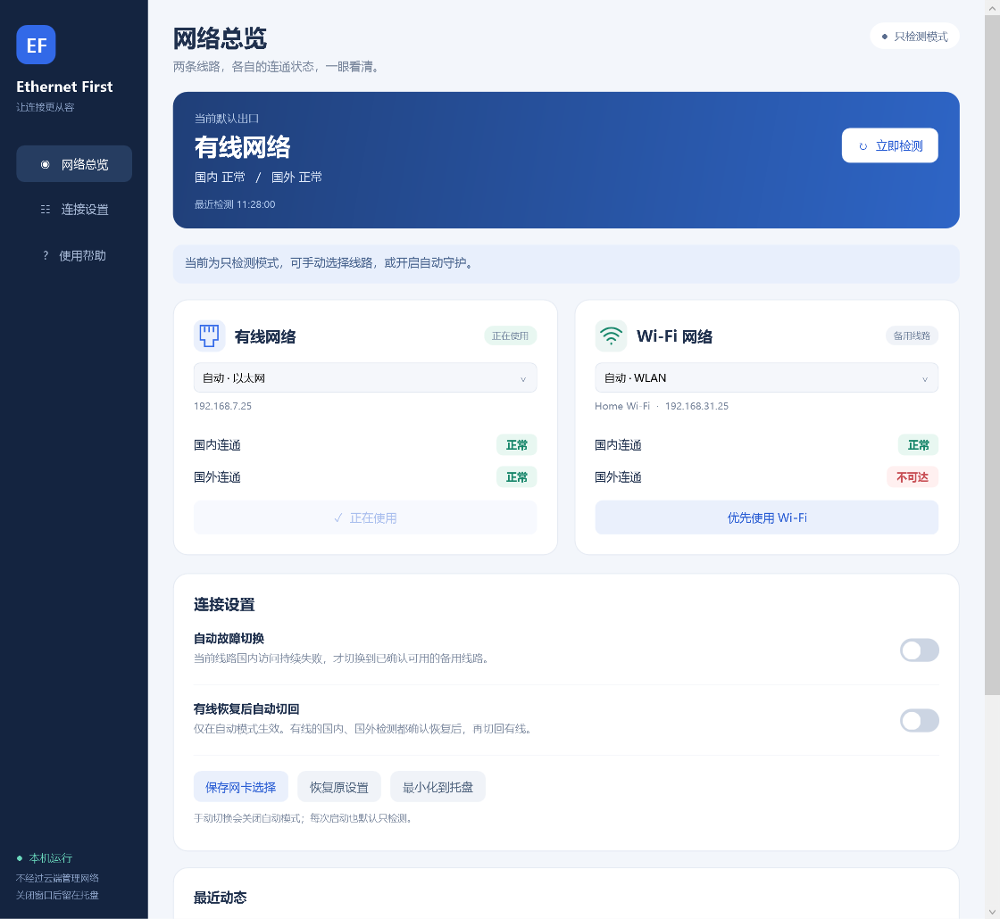

# Ethernet First — 双线路连通面板

[中文使用说明](README.zh-CN.md) · [English](README.en.md) · [原项目](https://github.com/w1zardz/windows-ethernet-first)

Windows 10 / 11 有线与 Wi-Fi 切换工具，基于上游 PowerShell / C# 修改，MIT 协议。

- 原生桌面主窗口，分别显示有线 / Wi-Fi 的**国内连通、国外连通**。
- 窗口和托盘均可手动选择线路，两张网卡保持连接。
- **默认只检测**，自动故障切换可随时开关。
- 当前线路国内检测持续失败，才使用国内可用的备用线路；国外单独失败不切换。
- 三分钟冷却；“有线恢复后自动切回”可独立开启，默认关闭。
- 按 GUID 保存原优先级；操作失败回滚，可恢复原设置。
- 不修改 GL 路由器、DNS、IP 或 VPN 配置。

下载完整代码后双击 **start.bat**，接受 Windows 管理员授权即可打开主窗口。关闭窗口后留在托盘，双击托盘可重新打开。不需要 Python 或额外模块。启动程序不会安装登录任务，也不会自行开启自动模式。

多网卡选择、检测站点、安装版与便携版状态目录及测试方法，详见[中文说明](README.zh-CN.md)。

[原版俄文说明](README.upstream.ru.md) 保留供参考，描述的是上游旧行为；本分支以当前中英文说明为准。
